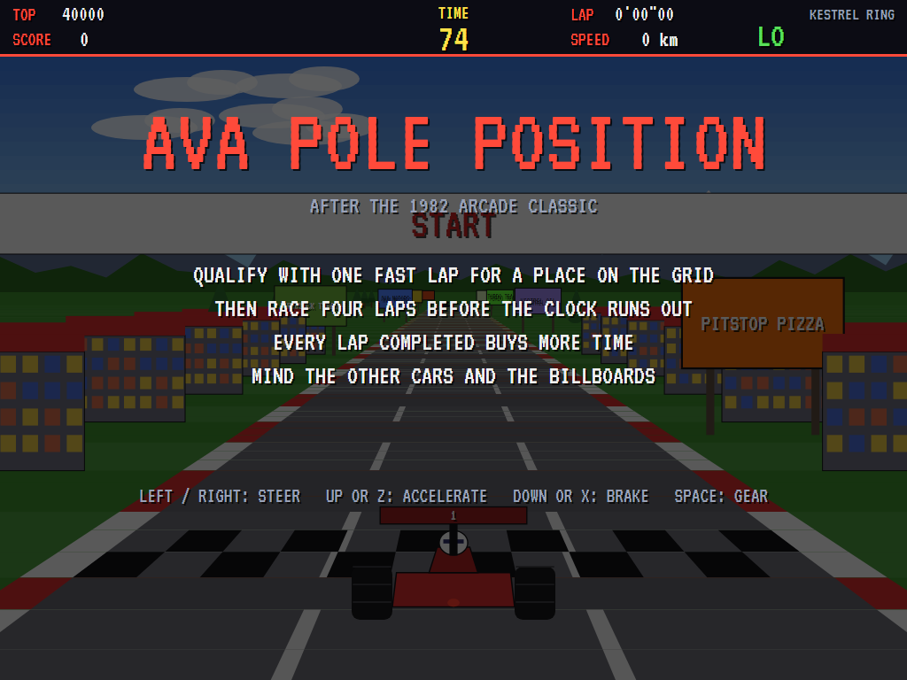
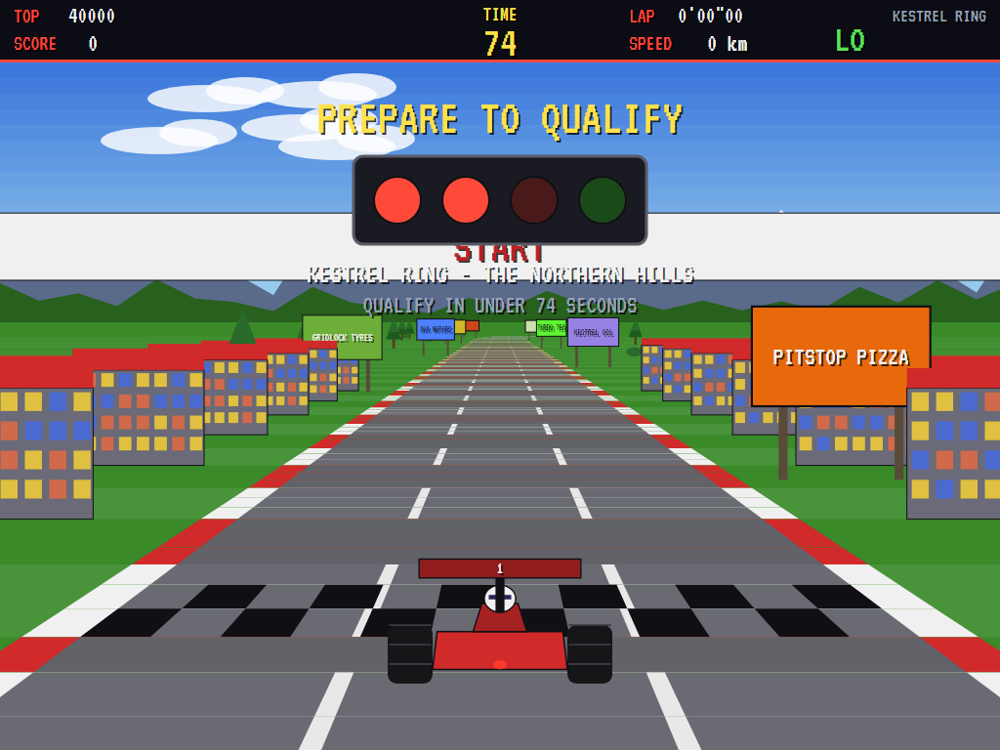
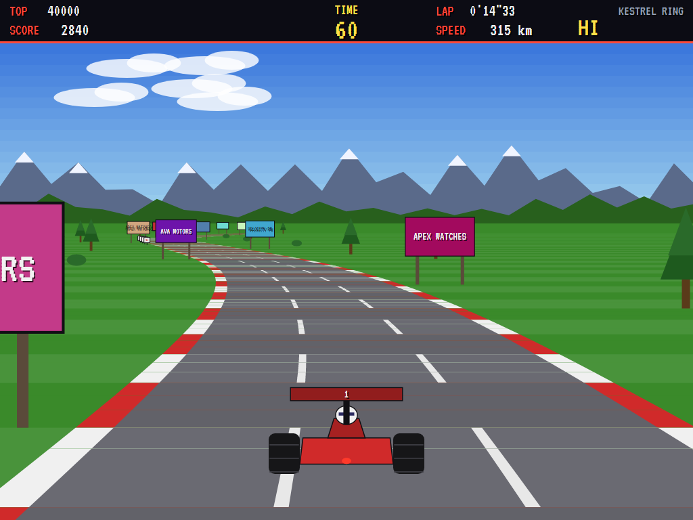
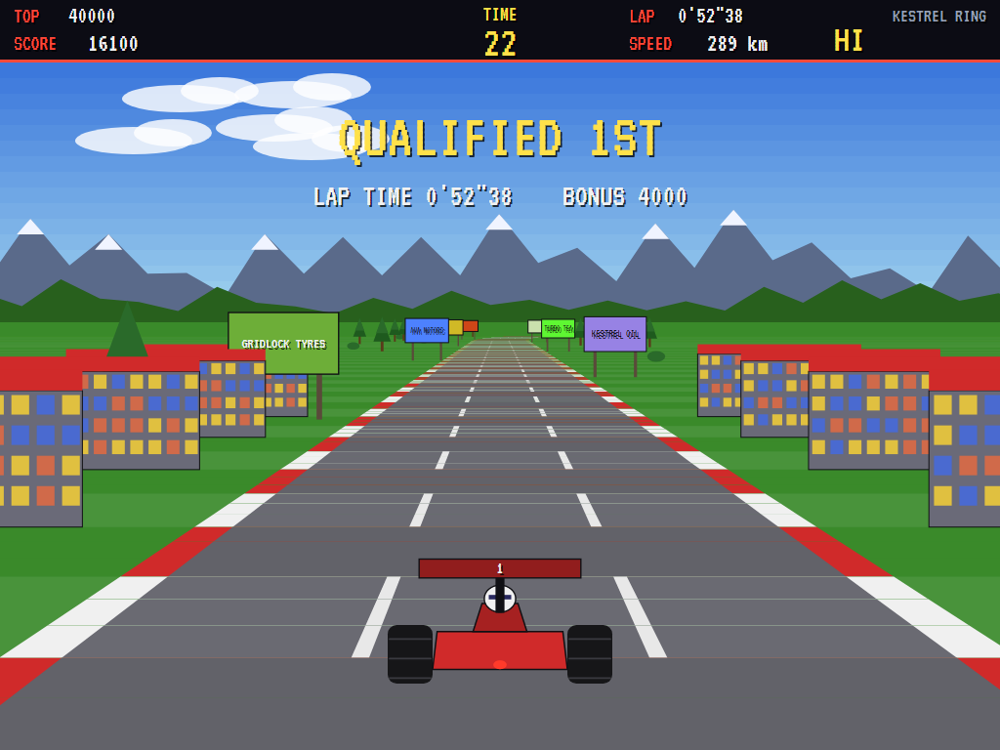
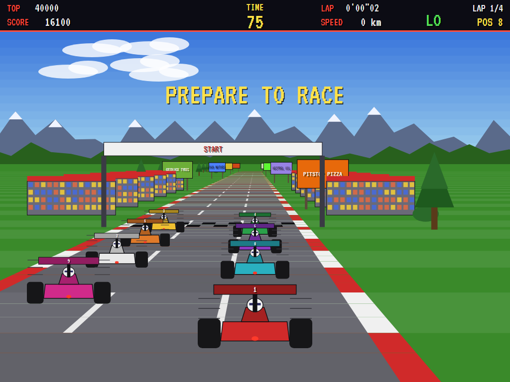
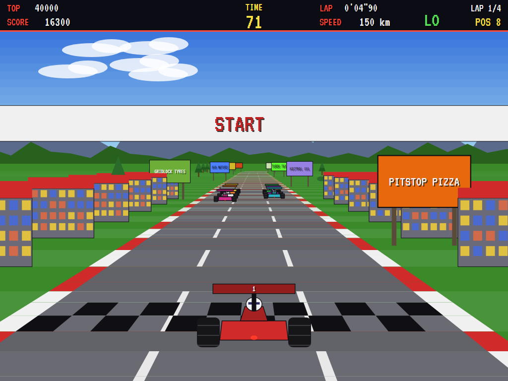
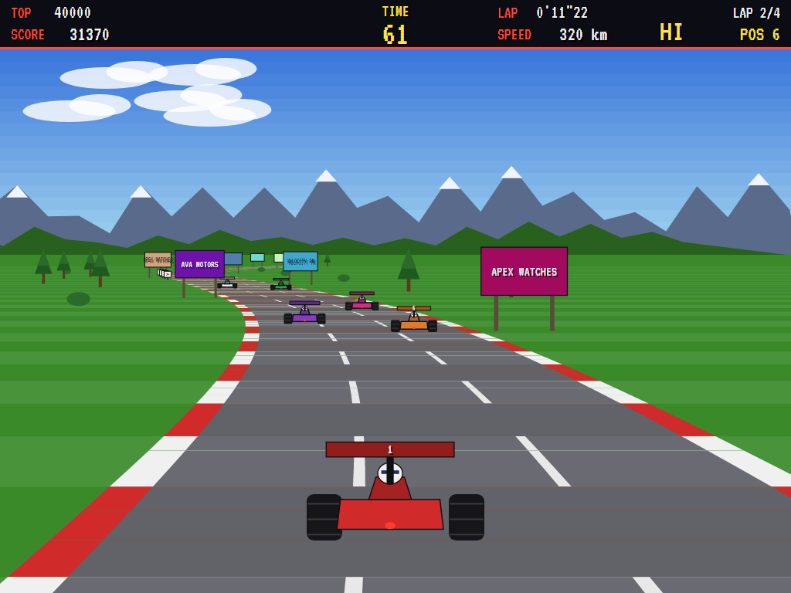
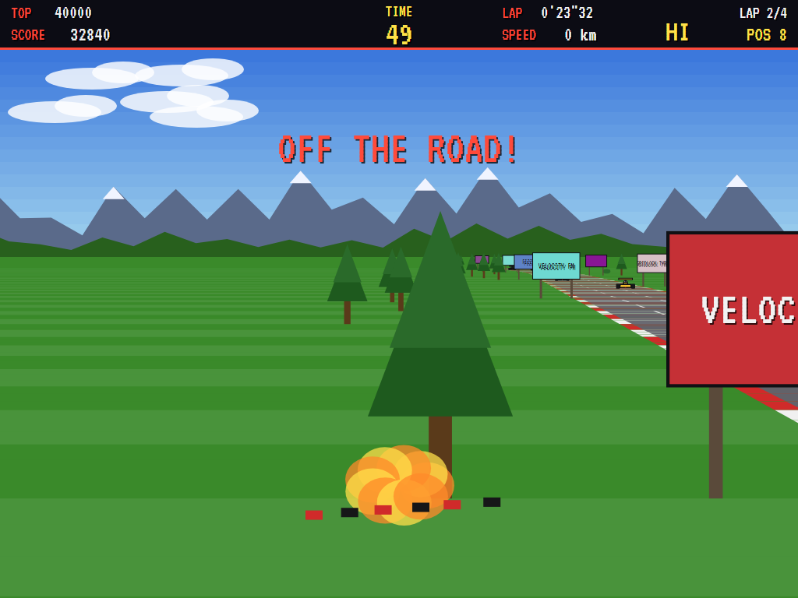
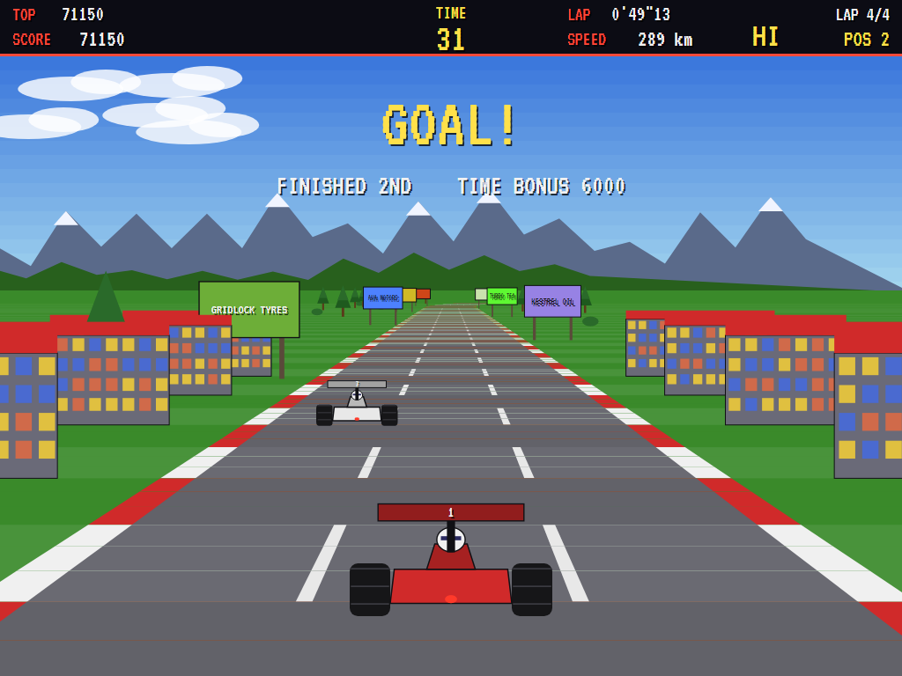
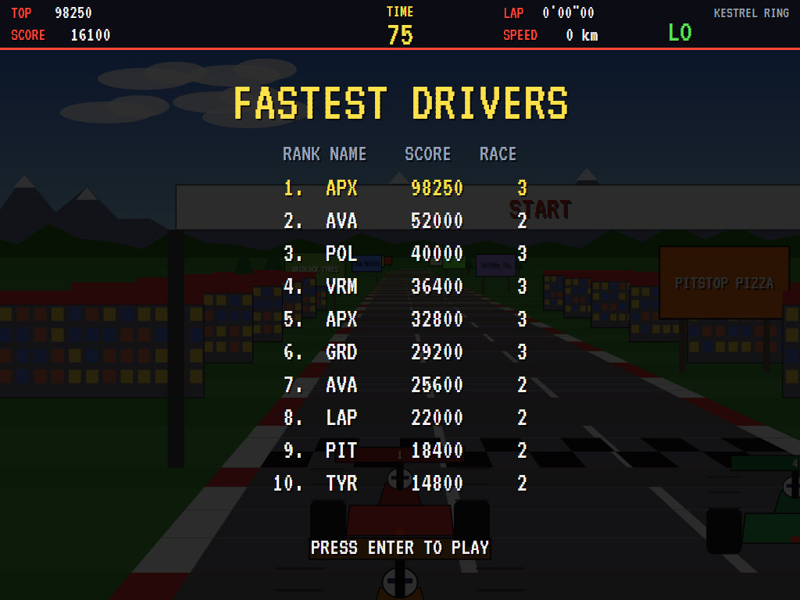

# AVA Pole Position

[](https://github.com/Harlock123/AVAPolePosition/actions/workflows/build.yml)

A Formula racer in the style of Namco's 1982 arcade game **Pole Position**, built with .NET 10 and
Avalonia UI. Seen from just behind the car, the road sweeps towards you round the bends, past
grandstands and billboards, with the mountains turning on the horizon. Qualify with one fast lap
for a place on the grid, then race four laps against seven other cars before the clock runs out.

## Features

- **Pseudo-3D racing**:
  - **The road:** a long run of segments that bend into curves, drawn in perspective with red and white kerbs, lane lines and rushing bands of colour.
  - **Scaling:** trees, chevrons, billboards, grandstands, the start gantry and the other cars grow as you close on them.
  - **The horizon:** clouds, snowy mountains and hills turn with the road, the nearer ones faster.
- **The car**:
  - **Gears:** low gear pulls hard but runs out of revs at 190 km/h; high gear goes on to 320 but crawls from a standstill. Change at the right moment.
  - **Bends:** they pull a fast car to the outside, so brake for the tight ones. The tyres squeal when you're near the limit.
  - **The grass:** it slows you down.
  - **Crashing:** hit a billboard, a tree or a grandstand, or run into the back of another car, and you crash in a ball of fire. You restart after a moment, at a standstill.
- **A race meeting**:
  - **Qualifying:** one flying lap against the clock. The faster it is, the higher you start, with a bonus from 200 points for 8th up to 4,000 for pole.
  - **Failing to qualify:** if you're too slow, the game is over.
  - **The race:** four laps from your grid place. The other drivers have their own top speeds, slow for the bends, and change lanes to get past each other.
  - **The clock:** every lap completed buys more time, and anything left at the flag is a bonus.
- **Three circuits** in turn, each with its own scenery and its own corners: the Kestrel Ring, Port Halvard and the Valley of Ash. The names and the boards along them are this game's own.
- **Scoring**:
  - 10 points for every stretch of road covered
  - 50 for each car passed in the race
  - the grid bonus
  - 200 a second for the time left at the flag
- **Sound**: an original driving march in D over the engine's drone, the start lights, gear changes, squealing tyres, rumbling over the grass, crashes, overtakes, laps and the extended-play chime. All mixed by OpenAL.
- **Attract mode**: leave the title alone for 15 seconds and a computer driver takes the wheel. It changes gear, brakes for the bends it sees coming, and picks a line round slower cars.
- **A top-ten high-score table** with arcade-style initials entry; it records the race reached.
- **Gamepads** through SDL2, as well as the keyboard: triggers for the pedals.
- **Any window size**: the screen scales to fit, letterboxed. **Ctrl+S** saves a screenshot.
- **One self-contained executable** per platform: Windows, macOS and Linux on Intel/AMD and ARM.

## Screenshots

| The title | Prepare to qualify | A sweeping bend |
|:---------:|:------------------:|:---------------:|
|  |  |  |
| How to race. | The lights, on the line. | Flat out in high gear. |

| Qualified | On the grid | Into traffic |
|:---------:|:-----------:|:------------:|
|  |  |  |
| Pole, and the bonus. | Starting at the back. | The field ahead. |

| Through the pack | Crashed | The flag |
|:----------------:|:-------:|:--------:|
|  |  |  |
| Lap two, passing into a bend. | Off the road and into the trees. | Second, with time to spare. |

| The fastest drivers | | |
|:-------------------:|:-:|:-:|
|  | | |
| The high-score table. | | |

The screenshots are made by the tests, which play the game in a real (headless) window; see
[Tests](#tests).

## Download and run

Ready-to-run builds for Windows, macOS and Linux, on both Intel/AMD and ARM, are on the
[Releases page](https://github.com/Harlock123/AVAPolePosition/releases/tag/latest). **Latest build** is
rebuilt on every push to `main`. Each download is one self-contained executable: no .NET install is
needed.

| Platform | Archive |
|---|---|
| Windows | `AVAPolePosition-win-x64.zip`, `AVAPolePosition-win-x86.zip`, `AVAPolePosition-win-arm64.zip` |
| macOS | `AVAPolePosition-osx-arm64.tar.gz` (Apple silicon), `AVAPolePosition-osx-x64.tar.gz` (Intel) |
| Linux | `AVAPolePosition-linux-x64.tar.gz`, `AVAPolePosition-linux-arm64.tar.gz`, `AVAPolePosition-linux-arm.tar.gz` |

```bash
tar -xzf AVAPolePosition-linux-x64.tar.gz     # or linux-arm64, linux-arm, osx-arm64, osx-x64
./AVAPolePosition
```

On Windows, unzip and run `AVAPolePosition.exe`. On macOS, if Gatekeeper refuses to open it, run
`xattr -d com.apple.quarantine AVAPolePosition` once. Run with `--no-audio` for silence.

**Sound** comes through OpenAL Soft, built in for every platform. In a virtual machine the game
detects it and uses a larger audio buffer, so the sound doesn't break up.

**Gamepads** use SDL2, which is bundled for Windows, macOS and Intel/AMD Linux. ARM Linux builds need it
installed; without it the keyboard still works:

```bash
sudo apt install libsdl2-dev            # Debian / Ubuntu / Raspberry Pi OS
sudo pacman -S --needed sdl2-compat     # Arch / Omarchy
```

## Controls

| Input | Action |
|-------|--------|
| **Enter** | Start |
| **Left** / **Right** (or **A** / **D**) | Steer |
| **Up** / **W** / **Z** / **Ctrl** (hold) | Accelerate |
| **Down** / **S** / **X** (hold) | Brake |
| **Space** / **Shift** | Change gear (low and high) |
| **P** / **Esc** | Pause (Esc again to quit) |
| **M** | Mute |
| **Ctrl+S** / **Cmd+S** | Save a screenshot to the Pictures folder |

**Gamepad**: left stick or D-pad to steer, **A** or the right trigger to accelerate, **B** or the left
trigger to brake, **X**, **Y** or a shoulder button to change gear, **Start** to start and pause,
**Back** (while paused) to quit.

**Entering initials**: type letters, or dial with **Up**/**Down** and accept with **Space**; **Left** /
**Backspace** go back; **Enter** finishes.

## Tests

```bash
dotnet test AVAPolePosition.slnx
```

The engine has no UI and runs in fixed 60 Hz steps, so it plays the same at any frame rate, and a seed
always plays the same game. The tests check, often on a plain test oval:

- **The car:**
  - low gear's pull and its limit, high gear's top speed and its crawl from a standstill
  - braking and lifting off, steering across the road and the grass slowing you
  - a bend pulling a fast car outwards but not a slow one
  - crashing into a billboard or the back of a car, and restarting on the road
- **The meeting:**
  - the lights holding the car, a fast qualifying lap taking pole and its bonus, and too slow a lap ending the game
  - every lap buying more time, and the flag after four
  - fifty points for a pass, and running out of time in the race
- **The other drivers and the circuits:** slowing for the bends, and every circuit a proper lap with its start gantry, its tight corners and the same scenery every time.
- **The machine:** the computer driver qualifying and winning the first race, the attract mode, initials, the same game from the same seed, and the high-score file.

The screenshot tests draw the real screen in a headless window. To refresh the README's pictures:

```bash
POLE_SHOTS=$PWD/Images dotnet test tests/AVAPolePosition.Tests --filter ScreenshotTests
```

To see how the computer driver gets on (for tuning):

```bash
POLE_PROBE=1 dotnet test tests/AVAPolePosition.Tests --filter DriverProbe --logger "console;verbosity=detailed"
```

## Building

```bash
dotnet build AVAPolePosition.slnx
dotnet run --project src/AVAPolePosition
```

Needs the .NET 10 SDK. The sounds are made by `tools/make_sounds.py` (standard-library Python):
`python3 tools/make_sounds.py` rewrites `src/AVAPolePosition/Sounds`.

## Project structure

```
AVAPolePosition/
├── AVAPolePosition.slnx
├── src/AVAPolePosition/
│   ├── Engine/
│   │   ├── GameEngine.cs        # States, the title and demo cycle, and the music
│   │   ├── GameEngine.Play.cs   # The car (gears, steering, bends, the grass), crashes,
│   │   │                        # qualifying, the grid, the race, laps and the clock, the other drivers
│   │   ├── Track.cs             # The three circuits: curves, roadside scenery and boards
│   │   ├── Driver.cs            # The computer driver, for the demonstration (and the tests)
│   │   ├── Entities.cs
│   │   ├── HighScoreTable.cs, InitialsEntry.cs
│   │   ├── InputHandler.cs, ControllerManager.cs  # Keys and an SDL2 gamepad
│   │   └── SoundManager.cs      # Effects, the racing music and the tunes through OpenAL
│   ├── Audio/                   # The OpenAL engine (from the author's AVABand)
│   ├── Views/                   # The road in perspective, the scenery, the cars and the screens
│   └── Sounds/                  # The synthesised effects and tunes
├── tests/AVAPolePosition.Tests/ # Gameplay, screenshot and probe tests
├── tools/make_sounds.py
└── Images/                      # Screenshots
```

## About and licence

AVA Pole Position © 2026 Lonnie Watson, under the [MIT License](LICENSE).

*Pole Position* © 1982 Namco; the name belongs to its current owner. AVA Pole Position is an
independent, unofficial game in its style. Its circuits, cars, roadside boards, graphics, sounds, tunes
and code are its own; nothing is taken from the arcade machine's program, graphics, sound or music,
and no real circuit or sponsor appears in it. It is not affiliated with or endorsed by any rights
holder.
